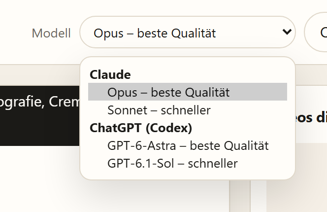
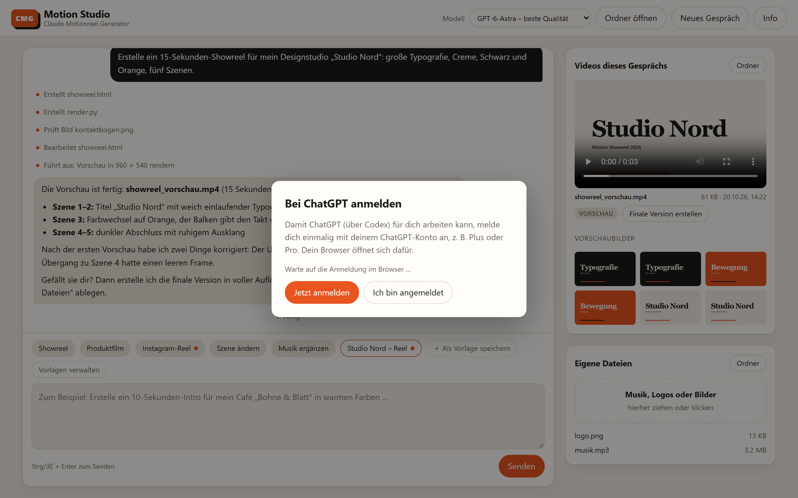

# Claude Motionreel Generator (CMG)

🇩🇪 [Deutsche Version](README.md)

**Your own studio for AI-made motion design videos, set up with a double-click.**

You describe the video you want in plain words. Claude turns that into an animation, checks the frames and saves the finished video as an MP4 file.

This package installs everything you need for that. You don't need any technical knowledge.

<picture>
  <source media="(prefers-color-scheme: dark)" srcset="docs/images/studio-dunkel.png">
  
</picture>

<sub>Motion Studio in the browser: your request and Claude's work steps on the left, the finished video on the right.</sub>

> **Note:** The installer, the studio interface and the example prompts are in German. Claude understands English just as well, so you can write all your requests in English.

---

## What you need

- A computer running **Windows 10/11**, **macOS** or **Linux** (Ubuntu, Debian, Fedora, Arch)
- An **internet connection** and about **3 GB of free disk space**
- A **Claude account with access to Claude Code**, for example Claude Pro or Max, **or** a **ChatGPT account with Codex access**, for example ChatGPT Plus or Pro
- About **15–30 minutes**. Most of it runs on its own.

---

## Installation

### Windows

1. At the top of this page, click the green **"Code"** button, then **"Download ZIP"**.
2. Open your Downloads folder. Right-click the ZIP file and choose **"Extract All"**.
3. Open the extracted folder and double-click **`Windows-Installation.bat`**.
4. If Windows shows a warning ("Windows protected your PC"), click **"More info"**, then **"Run anyway"**.
5. If Windows asks "Do you want to allow this app to make changes…", click **"Yes"**.

<details>
<summary>Alternative: one-line install (for advanced users)</summary>

Open **PowerShell** from the Start menu, paste this line and press Enter:

```powershell
irm https://raw.githubusercontent.com/normannormalmann/Claude-Motionreel-Generator-CMG/main/install.ps1 -OutFile "$env:TEMP\cmg.ps1"; powershell -ExecutionPolicy Bypass -File "$env:TEMP\cmg.ps1"
```
</details>

### Mac

1. Open the **Terminal** app: press `⌘ Cmd` + `Space`, type `Terminal` and press Enter.
2. Copy this line, paste it into Terminal (`⌘ Cmd` + `V`) and press Enter:

```bash
curl -fsSL https://raw.githubusercontent.com/normannormalmann/Claude-Motionreel-Generator-CMG/main/install.sh | bash
```

3. When asked for your **password**, type your Mac password and press Enter. **Nothing appears while you type.** That's normal.
4. If your Mac offers to install the "command line developer tools", click **"Install"**.
5. If your Mac asks whether "Terminal" may access your **Documents** folder, click **"Allow"**.

<details>
<summary>Alternative: double-click instead of Terminal</summary>

Download the ZIP file as described for Windows and double-click **`Mac-Installation.command`**.
If macOS says the file can't be opened, go to **System Settings → Privacy & Security**, scroll down and click **"Open Anyway"**.
</details>

### Linux

Open a terminal, paste this line and press Enter:

```bash
curl -fsSL https://raw.githubusercontent.com/normannormalmann/Claude-Motionreel-Generator-CMG/main/install.sh | bash
```

When asked for your password, type it and press Enter. Nothing appears while you type.

---

## Your first video

1. Double-click **"Motion Studio"** on your desktop. On a Mac you'll also find it in Finder under **Applications**. The studio opens in your browser.
2. The first time, click **"Jetzt anmelden"** (sign in now) and sign in with your Claude account.
3. Pick a template at the bottom, such as **"Showreel"**, or describe your video in your own words. Then click **"Senden"** (send). You can write in English.
4. Claude plans, renders and checks the video. The left side shows what Claude is working on. First you always get a quick low-resolution **preview** ("Vorschau"). It appears on the right and plays right there.
5. To make changes, just keep writing, for example "Make the second scene slower".
6. Happy with the preview? Click **"Finale Version erstellen"** (create final version) on the right. Only then is the video rendered at full resolution.


<sub>The first time, you sign in to Claude right inside the studio.</sub>

Drag your own music, logos or images into the **"Eigene Dateien"** (your files) box on the right. **"Neues Gespräch"** (new conversation) starts a new project. Your videos are kept.

> **Good to know:** So you don't have to confirm every step, Claude may create files and run commands (for example to render) on its own in the studio. The studio can only be reached from your own computer, via the "Motion Studio" icon. Claude basically has the same permissions as you, so only give it files and web pages you trust. The same applies to ChatGPT (Codex): in the studio it runs without its own security sandbox, with web search and extensions turned off.

The template buttons are in German. Here's an English request you can paste instead:

```
Create a 15-second motion design showreel for a fictional design studio.
Format: 1920 × 1080 pixels, 30 fps. Style: editorial, precise, large typography,
cream background, black text and orange accents. Plan five scenes with different
motion ideas. No audio for now. Create a contact sheet, check the frames, and render
a 960 × 540 preview. We'll do the full-resolution version once I like the preview.
```

More example requests (in German) are in **`BEISPIEL-PROMPTS.md`** in your studio folder.

**Where is my studio folder?**

| System | Folder |
|---|---|
| Windows | **Documents** → `Claude-Motion-Studio` |
| Mac | **Documents** → `Claude-Motion-Studio` |
| Linux | **Documents** → `Claude-Motion-Studio` |

Inside you'll find:

- `exports`: your videos, with a subfolder for each conversation. The studio only shows the current conversation's videos on the right.
- `projekte`: the source files of the animations, also one folder per conversation
- `assets`: put your own music, logos or images here
- `BEISPIEL-PROMPTS.md`: more example requests
- `presets.json`: your own templates
- `CLAUDE.md`: the AI's working rules. They apply to both Claude and ChatGPT. You can edit them.

---

## Using ChatGPT instead of Claude

Under **"Modell"** (model) at the top right, you choose who builds your video:

| Choice | Service | Sign-in |
|---|---|---|
| Opus, Sonnet | Claude (Claude Code) | Claude account, e.g. Pro or Max |
| GPT-6-Astra, GPT-6.1-Sol | ChatGPT (via OpenAI Codex) | ChatGPT account, e.g. Plus or Pro |



The first time you pick a GPT model, the studio asks you to sign in with ChatGPT. You don't need an API key. Usage counts against your ChatGPT plan's limits.



You can also switch in the middle of a conversation. The new service doesn't know the conversation so far, though. Briefly tell it what you're working on, or start a **"Neues Gespräch"** (new conversation).

---

## Updates

Once a day, the studio checks whether a new version is available. If there is one, an **"Update verfügbar"** (update available) button appears at the top. Click it to see what changes, then **"Jetzt aktualisieren"** (update now) installs the update:

- The update is blocked while a job is running, so no render is lost.
- The studio closes briefly, updates in the background and then reopens on its own in a new tab.
- Your videos, files, templates, conversations and your `CLAUDE.md` are kept.
- If the update fails, the studio starts with the previous version and shows where the log is.

Every new version is tested automatically on Windows, macOS and Linux first. For the check, the studio only downloads the file `versions.json` from GitHub; no data about you or your projects is sent. Claude Code keeps updating itself as usual.

> **Good to know:** the studio update doesn't update system programs such as FFmpeg, Python and Node.js. Your system keeps those up to date, for example via winget, Homebrew or your Linux package manager. On Linux the installer needs your password for them, so run it by hand now and then.

---

## Templates

Below the input field you'll find ready-made templates such as **"Showreel"**, **"Produktfilm"** (product film) and **"Instagram-Reel"**. You can also create your own:

- **Save:** write a request and click **"＋ Als Vorlage speichern"** (save as template).
- **Placeholders:** words in square brackets such as `[Product]` or `[Audience]` are asked for in a small form when you use the template.
- **Brand settings:** set the format (e.g. 9:16 for Reels), length, colors, fonts, logo and other notes. The studio automatically adds them to every request made with that template. Templates with brand settings show an orange dot.
- **Manage:** under **"Vorlagen verwalten"** (manage templates) you can edit, copy, delete, export and import templates, for example to share them with your team.


Your own templates are stored as `presets.json` in the studio folder, so they're included in your backups.

---

## What gets installed

| Program | What it's for |
|---|---|
| **Claude Code** | The AI that plans and builds your videos |
| **Codex** (optional) | Lets you use ChatGPT instead of Claude. Installed via Node.js. |
| **Motion Studio** | The browser interface you use to work with the AI |
| **Python** with Playwright, Pillow and NumPy | Drives the rendering of individual frames |
| **Chromium** (via Playwright) | An invisible browser that captures the animation frame by frame |
| **FFmpeg** | Combines the frames into an MP4 file |
| **Node.js** | Helper tool for Claude (optional) |
| **Git** (Windows only) | Needed by Claude Code on Windows |
| **Homebrew** (Mac only) | Package manager used to install Python and FFmpeg |

The Python environment is deliberately kept out of your Documents folder, in the hidden application data folder. That way it doesn't slow down OneDrive or iCloud sync.

Programs you already have are detected and not installed twice. You can safely run the installation again. It won't overwrite your own `CLAUDE.md`.

At the end, the installer renders a short test animation to confirm that everything works.

---

## Troubleshooting

| Problem | Solution |
|---|---|
| The installation stops with "FEHLER" (error) | Just run it again. If that doesn't help, send the file `cmg-install.log` from your temp folder to support. The error message shows its path. |
| The studio doesn't open | Wait a few seconds and double-click "Motion Studio" again. Restarting your computer also helps. |
| "Verbindung zum Studio unterbrochen" (connection lost) | The studio shuts down a few minutes after you close its browser tab. Just start it again via "Motion Studio". |
| Windows: "winget ist nicht verfügbar" (winget not available) | Install **"App Installer"** from the Microsoft Store and run the installation again. |
| Windows: Python is not found | Install Python 3.13 from [python.org](https://www.python.org/downloads/), tick **"Add python.exe to PATH"**, then run the installation again. |
| The video shows blank or wrong frames | Ask Claude to check `window.seek()`, image and font loading, and the capture timing. |
| The video feels hectic | Ask Claude for fewer scenes, longer holds and calmer transitions. |
| Fedora: the self-test reports missing H.264 | Enable [RPM Fusion](https://rpmfusion.org/Configuration) and install `ffmpeg` from it. |
| "Codex wurde nicht gefunden" (Codex not found) | Run the installer again. It sets up Codex too. Codex needs Node.js. |
| ChatGPT reports a usage limit | Your ChatGPT plan has used up its Codex allowance. Wait until it resets, or switch to Claude at the top. |

---

## For advanced users

- **Different studio folder:** set the environment variable `CMG_STUDIO_DIR` before installing.
- **Install without prompts:** `CMG_NONINTERACTIVE=1`
- **Turn off the update check:** set the environment variable `CMG_NO_UPDATE_CHECK=1`.
- **Tested versions:** `versions.json` sets the studio version and the tested versions of Codex, Playwright, Pillow and NumPy. A weekly GitHub workflow (**Versions-Check**) looks for new versions, tests them with the installer and then proposes them as a pull request. To let it create PRs, enable "Allow GitHub Actions to create and approve pull requests" under **Settings → Actions → General**; otherwise it opens an issue instead. If you change the studio, raise `cmg` in `versions.json`. Only then do installed studios offer the update.
- **Use Claude Code directly in a terminal:** run `studio-im-terminal.ps1` (Windows) or `studio-im-terminal.sh` (Mac/Linux) in the studio folder.
- **Studio app log:** `studio-app.log` in the app data folder (`%LOCALAPPDATA%\Claude-Motion-Studio` or `~/.local/share/claude-motion-studio`).
- Every change is tested automatically on Windows, macOS and Ubuntu. See the **Actions** tab for the current status.

---

## Contact

Made by **Norman Schönherr**. Questions, ideas or feedback? Get in touch.

- Website: [normanschoenherr.de](https://normanschoenherr.de)
- Email: [hey@normanschoenherr.de](mailto:hey@normanschoenherr.de)
- Instagram: [@normanschonherr](https://www.instagram.com/normanschonherr/)

You'll also find these details in the studio under the **"Info"** button.

---

## Disclaimer

You use this project at your own risk. The software is provided as is, without warranty (see [License](LICENSE)).

- **Third-party software:** The installer downloads and installs software from other providers, including Claude Code, Python, Playwright with Chromium, FFmpeg, Node.js, Git and Homebrew. Their own licenses and terms apply. I take no responsibility for how they work, their security or their availability.
- **AI that acts on its own:** In the studio, Claude creates and changes files and runs commands on your computer on its own. AI results can be wrong or unexpected. Back up important data regularly and only give Claude files and web pages you trust.
- **Costs and account:** Claude requires your own account with a suitable plan or API billing. Any resulting costs and usage limits are your responsibility.
- **Data transfer:** Your requests, and the content the AI reads to fulfil them, are sent to Anthropic for processing, or to OpenAI if you choose a GPT model. The provider's privacy policy and terms of use apply. Don't process confidential data or other people's personal data without permission.
- **Rights to content:** You are responsible for holding the rights to any content you use, such as music, logos, images and fonts. The same applies to how you use the videos you create.
- **Not affiliated with Anthropic or OpenAI:** Claude and Claude Code are trademarks or products of Anthropic; ChatGPT and Codex are products of OpenAI. This project is independent and is not endorsed or reviewed by either company.

To the extent permitted by law, liability for damages arising from use is excluded. This does not affect liability for intent and gross negligence, for injury to life, body or health, or under mandatory statutory provisions such as product liability law.

---

## License

[MIT](LICENSE) © 2026 Norman Schönherr
