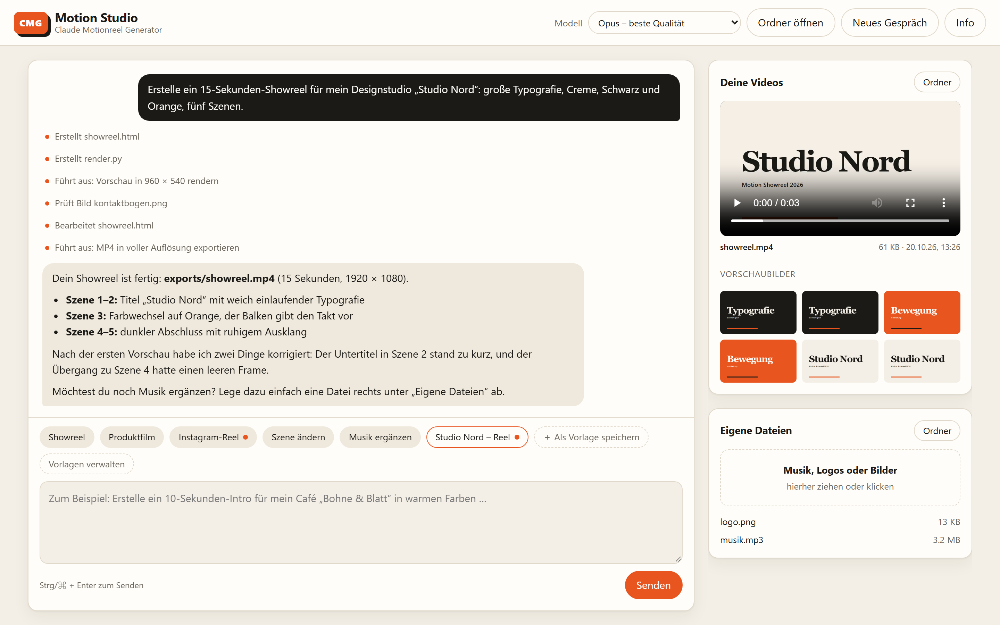
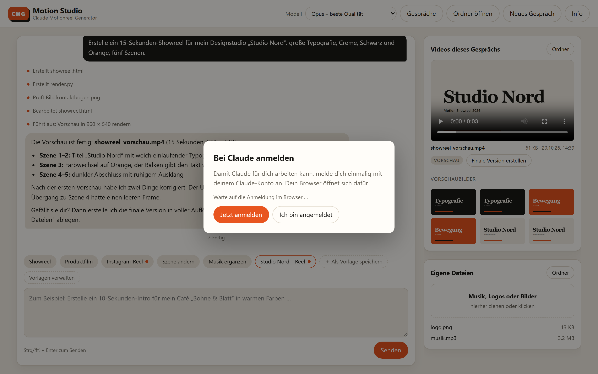
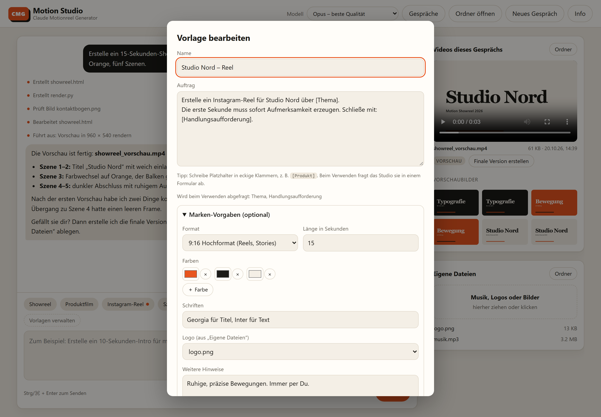
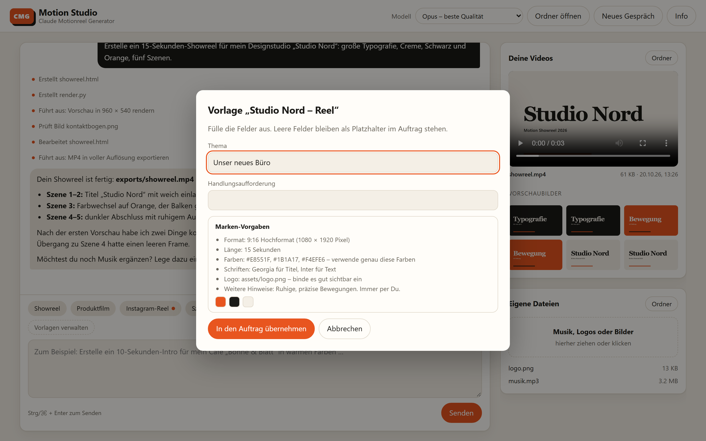

# Claude Motionreel Generator (CMG)

🇬🇧 [English version](README.en.md)

**Dein eigenes Studio für KI-erstellte Motion-Design-Videos, eingerichtet mit einem Doppelklick.**

Du beschreibst Claude in normalen Worten, welches Video du möchtest. Claude baut daraus eine Animation, prüft die Einzelbilder und speichert das fertige Video als MP4-Datei.

Dieses Paket installiert alles, was dafür nötig ist. Technische Vorkenntnisse brauchst du nicht.

<picture>
  <source media="(prefers-color-scheme: dark)" srcset="docs/images/studio-dunkel.png">
  
</picture>

<sub>Das Motion Studio im Browser: links der Auftrag und Claudes Arbeitsschritte, rechts das fertige Video.</sub>

---

## Was du brauchst

- Einen Computer mit **Windows 10/11**, **macOS** oder **Linux** (Ubuntu, Debian, Fedora, Arch)
- Eine **Internetverbindung** und etwa **3 GB freien Speicherplatz**
- Ein **Claude-Konto mit Zugang zu Claude Code**, z. B. Claude Pro oder Max, **oder** ein **ChatGPT-Konto mit Codex-Zugang**, z. B. ChatGPT Plus oder Pro
- Etwa **15–30 Minuten**. Der Großteil läuft automatisch.

---

## Installation

### Windows

1. Klicke oben auf dieser Seite auf den grünen Knopf **„Code“** und dann auf **„Download ZIP“**.
2. Öffne deinen Download-Ordner. Klicke mit der rechten Maustaste auf die ZIP-Datei und wähle **„Alle extrahieren“**.
3. Öffne den entpackten Ordner und doppelklicke auf **`Windows-Installation.bat`**.
4. Falls Windows warnt („Der Computer wurde durch Windows geschützt“): Klicke auf **„Weitere Informationen“** und dann auf **„Trotzdem ausführen“**.
5. Fragt Windows zwischendurch „Möchten Sie zulassen, dass …“, klicke auf **„Ja“**.

<details>
<summary>Alternative: Installation mit einer Zeile (für Fortgeschrittene)</summary>

Öffne über das Startmenü **PowerShell**, füge diese Zeile ein und drücke Enter:

```powershell
irm https://raw.githubusercontent.com/normannormalmann/Claude-Motionreel-Generator-CMG/main/install.ps1 -OutFile "$env:TEMP\cmg.ps1"; powershell -ExecutionPolicy Bypass -File "$env:TEMP\cmg.ps1"
```
</details>

### Mac

1. Öffne das Programm **Terminal**. Drücke dazu `⌘ Cmd` + `Leertaste`, tippe `Terminal` und drücke Enter.
2. Kopiere diese Zeile, füge sie im Terminal ein (`⌘ Cmd` + `V`) und drücke Enter:

```bash
curl -fsSL https://raw.githubusercontent.com/normannormalmann/Claude-Motionreel-Generator-CMG/main/install.sh | bash
```

3. Wenn du nach deinem **Passwort** gefragt wirst, gib dein Mac-Passwort ein und drücke Enter. **Beim Tippen erscheinen keine Zeichen.** Das ist normal.
4. Bietet dein Mac an, die „Befehlszeilen-Entwicklerwerkzeuge“ zu installieren, klicke auf **„Installieren“**.
5. Fragt dein Mac, ob „Terminal“ auf den Ordner **Dokumente** zugreifen darf, klicke auf **„Erlauben“**.

<details>
<summary>Alternative: Doppelklick statt Terminal</summary>

Lade wie bei Windows die ZIP-Datei herunter und doppelklicke auf **`Mac-Installation.command`**.
Meldet macOS, dass die Datei nicht geöffnet werden kann: Öffne **Systemeinstellungen → Datenschutz & Sicherheit**, scrolle nach unten und klicke auf **„Dennoch öffnen“**.
</details>

### Linux

Öffne ein Terminal, füge diese Zeile ein und drücke Enter:

```bash
curl -fsSL https://raw.githubusercontent.com/normannormalmann/Claude-Motionreel-Generator-CMG/main/install.sh | bash
```

Wenn du nach deinem Passwort gefragt wirst, gib es ein und drücke Enter. Beim Tippen erscheinen keine Zeichen.

---

## Dein erstes Video

1. Doppelklicke auf **„Motion Studio“** auf deinem Schreibtisch bzw. Desktop. Auf dem Mac findest du es auch im Finder unter **Programme**. Das Studio öffnet sich in deinem Browser.
2. Beim ersten Start klickst du auf **„Jetzt anmelden“** und meldest dich mit deinem Claude-Konto an.
3. Klicke unten auf eine Vorlage, z. B. **„Showreel“**, oder beschreibe dein Video in eigenen Worten. Klicke dann auf **„Senden“**.
4. Claude plant, rendert und prüft das Video. Du siehst links, woran Claude gerade arbeitet. Fertige Videos erscheinen rechts und lassen sich direkt abspielen.
5. Für Änderungen schreibst du einfach weiter, z. B. „Mach die zweite Szene langsamer“.



<sub>Beim ersten Start meldest du dich direkt im Studio bei Claude an.</sub>

Eigene Musik, Logos oder Bilder ziehst du rechts in das Feld **„Eigene Dateien“**. Mit **„Neues Gespräch“** beginnst du ein neues Projekt. Deine Videos bleiben dabei erhalten.

> **Gut zu wissen:** Damit du nicht bei jedem Schritt etwas bestätigen musst, darf Claude im Studio selbstständig Dateien anlegen und Befehle ausführen, etwa zum Rendern. Das Studio ist nur auf deinem eigenen Computer und nur über das Symbol „Motion Studio“ erreichbar. Claude hat dabei grundsätzlich dieselben Rechte wie du. Gib Claude deshalb nur Dateien und Webseiten zur Verarbeitung, denen du vertraust. Für ChatGPT (Codex) gilt dasselbe: Es läuft im Studio ohne eigene Sicherheits-Sandbox. Websuche und Erweiterungen sind dafür abgeschaltet.

**Wo ist mein Studio-Ordner?**

| System | Ordner |
|---|---|
| Windows | **Dokumente** → `Claude-Motion-Studio` |
| Mac | **Dokumente** → `Claude-Motion-Studio` |
| Linux | **Dokumente** bzw. **Documents** → `Claude-Motion-Studio` |

Darin findest du:

- `exports`: deine fertigen Videos
- `assets`: hier legst du eigene Musik, Logos oder Bilder ab
- `BEISPIEL-PROMPTS.md`: weitere Beispiel-Aufträge
- `presets.json`: deine eigenen Vorlagen
- `CLAUDE.md`: die Arbeitsregeln für die KI. Sie gelten für Claude und ChatGPT. Du kannst sie anpassen.

---

## ChatGPT statt Claude verwenden

Oben rechts unter **„Modell“** wählst du, wer dein Video baut:

| Auswahl | Dienst | Anmeldung |
|---|---|---|
| Opus, Sonnet | Claude (Claude Code) | Claude-Konto, z. B. Pro oder Max |
| GPT-6-Astra, GPT-6.1-Sol | ChatGPT (über OpenAI Codex) | ChatGPT-Konto, z. B. Plus oder Pro |

Wählst du zum ersten Mal ein GPT-Modell, fragt das Studio nach deiner ChatGPT-Anmeldung. Ein API-Schlüssel ist nicht nötig. Die Nutzung läuft über die Grenzen deines ChatGPT-Abos.

Du kannst auch mitten im Gespräch wechseln. Der neue Dienst kennt den bisherigen Verlauf aber nicht. Beschreib ihm kurz, woran ihr gerade arbeitet, oder beginne ein **„Neues Gespräch“**.

---

## Vorlagen

Unter dem Eingabefeld findest du fertige Vorlagen wie **„Showreel“**, **„Produktfilm“** oder **„Instagram-Reel“**. Du kannst auch eigene anlegen:

- **Speichern:** Schreib einen Auftrag und klicke auf **„＋ Als Vorlage speichern“**.
- **Platzhalter:** Begriffe in eckigen Klammern wie `[Produkt]` oder `[Zielgruppe]` fragt das Studio beim Verwenden in einem kleinen Formular ab.
- **Marken-Vorgaben:** Leg Format (z. B. 9:16 für Reels), Länge, Farben, Schriften, Logo und weitere Hinweise fest. Das Studio hängt sie automatisch an jeden Auftrag mit dieser Vorlage an. Vorlagen mit Marken-Vorgaben haben einen orangen Punkt.
- **Verwalten:** Unter **„Vorlagen verwalten“** kannst du Vorlagen bearbeiten, kopieren, löschen und als Datei exportieren oder importieren, z. B. um sie im Team zu teilen.





Eigene Vorlagen liegen als `presets.json` im Studio-Ordner. So sind sie in deiner Datensicherung enthalten.

---

## Was genau installiert wird

| Programm | Wofür |
|---|---|
| **Claude Code** | Die KI, die deine Videos plant und baut |
| **Codex** (optional) | Damit kannst du statt Claude auch ChatGPT verwenden. Wird über Node.js installiert. |
| **Motion Studio** | Die Oberfläche im Browser, über die du mit der KI arbeitest |
| **Python** mit Playwright, Pillow und NumPy | Steuert das Rendern der Einzelbilder |
| **Chromium** (über Playwright) | Ein unsichtbarer Browser, der die Animation abfotografiert |
| **FFmpeg** | Setzt die Einzelbilder zu einer MP4-Datei zusammen |
| **Node.js** | Hilfswerkzeug für Claude (optional) |
| **Git** (nur Windows) | Wird von Claude Code unter Windows benötigt |
| **Homebrew** (nur Mac) | Paketverwaltung, über die Python und FFmpeg installiert werden |

Die Python-Umgebung liegt bewusst nicht im Ordner Dokumente, sondern im versteckten Programmdaten-Ordner. So bremst sie OneDrive oder iCloud nicht aus.

Bereits installierte Programme werden erkannt und nicht doppelt installiert. Du kannst die Installation gefahrlos erneut starten. Deine eigene `CLAUDE.md` wird dabei nicht überschrieben.

Am Ende rendert der Installer automatisch eine kurze Testanimation. So ist sichergestellt, dass alles funktioniert.

---

## Häufige Probleme

| Problem | Lösung |
|---|---|
| Die Installation bricht mit „FEHLER“ ab | Starte sie einfach noch einmal. Hilft das nicht, schicke die Datei `cmg-install.log` aus deinem Temp-Ordner an den Support. Den Pfad zeigt die Fehlermeldung an. |
| Das Studio öffnet sich nicht | Warte ein paar Sekunden und doppelklicke erneut auf „Motion Studio“. Ein Neustart des Computers hilft ebenfalls. |
| „Verbindung zum Studio unterbrochen“ | Das Studio beendet sich einige Minuten, nachdem du den Browser-Tab geschlossen hast. Starte es einfach wieder über „Motion Studio“. |
| Windows: „winget ist nicht verfügbar“ | Installiere im Microsoft Store die App **„App-Installer“** und starte die Installation erneut. |
| Windows: Python wird nicht gefunden | Installiere Python 3.13 von [python.org](https://www.python.org/downloads/), setze dabei den Haken bei **„Add python.exe to PATH“** und starte die Installation erneut. |
| Das Video zeigt leere oder falsche Bilder | Bitte Claude, `window.seek()`, das Laden der Bilder und Schriften und den Aufnahmezeitpunkt zu prüfen. |
| Das Video wirkt hektisch | Bitte Claude um weniger Szenen, längere Standzeiten und ruhigere Übergänge. |
| Fedora: Der Selbsttest meldet fehlendes H.264 | Aktiviere [RPM Fusion](https://rpmfusion.org/Configuration) und installiere `ffmpeg` daraus. |
| „Codex wurde nicht gefunden“ | Starte den Installer erneut, er richtet Codex mit ein. Codex braucht Node.js. |
| ChatGPT meldet ein erreichtes Nutzungslimit | Dein ChatGPT-Abo hat sein Kontingent für Codex aufgebraucht. Warte, bis es sich erneuert, oder wechsle oben zu Claude. |

---

## Für Fortgeschrittene

- **Anderer Studio-Ordner:** Setze vor der Installation die Umgebungsvariable `CMG_STUDIO_DIR`.
- **Ohne Rückfragen installieren:** `CMG_NONINTERACTIVE=1`
- **Claude Code direkt in der Konsole:** `studio-im-terminal.ps1` (Windows) oder `studio-im-terminal.sh` (Mac/Linux) im Studio-Ordner.
- **Protokoll der Studio-App:** `studio-app.log` im Programmdaten-Ordner (`%LOCALAPPDATA%\Claude-Motion-Studio` bzw. `~/.local/share/claude-motion-studio`).
- Jede Änderung wird automatisch unter Windows, macOS und Ubuntu getestet. Den Stand siehst du unter **Actions**.

---

## Kontakt

Entwickelt von **Norman Schönherr**. Fragen, Ideen oder Feedback? Melde dich gern.

- Webseite: [normanschoenherr.de](https://normanschoenherr.de)
- E-Mail: [hey@normanschoenherr.de](mailto:hey@normanschoenherr.de)
- Instagram: [@normanschonherr](https://www.instagram.com/normanschonherr/)

Die Kontaktdaten findest du auch im Studio über den Knopf **„Info“**.

---

## Haftungsausschluss

Die Nutzung dieses Projekts erfolgt auf eigene Gefahr. Die Software wird ohne Gewährleistung bereitgestellt, wie sie ist (siehe [Lizenz](LICENSE)).

- **Programme anderer Anbieter:** Der Installer lädt und installiert Programme anderer Anbieter, unter anderem Claude Code, Python, Playwright mit Chromium, FFmpeg, Node.js, Git und Homebrew. Für diese gelten deren eigene Lizenzen und Nutzungsbedingungen. Für ihre Funktion, Sicherheit und Verfügbarkeit übernehme ich keine Verantwortung.
- **Selbstständig arbeitende KI:** Claude legt im Studio selbstständig Dateien an, ändert sie und führt Befehle auf deinem Computer aus. KI-Ergebnisse können fehlerhaft oder unerwartet sein. Sichere wichtige Daten regelmäßig und gib Claude nur Dateien und Webseiten, denen du vertraust.
- **Kosten und Konto:** Für Claude brauchst du ein eigenes Konto mit passendem Abo oder eine API-Abrechnung. Dabei entstehende Kosten und Nutzungslimits liegen bei dir.
- **Datenübertragung:** Deine Aufträge und die Inhalte, die die KI dafür liest, werden zur Verarbeitung an Anthropic übertragen, bei Auswahl eines GPT-Modells an OpenAI. Es gelten die Datenschutz- und Nutzungsbedingungen des jeweiligen Anbieters. Verarbeite keine vertraulichen oder personenbezogenen Daten Dritter ohne Berechtigung.
- **Rechte an Inhalten:** Du bist selbst dafür verantwortlich, dass du die Rechte an verwendeten Inhalten hast, etwa an Musik, Logos, Bildern und Schriften. Das gilt auch für die Nutzung der erzeugten Videos.
- **Keine Verbindung zu Anthropic oder OpenAI:** Claude und Claude Code sind Marken bzw. Produkte von Anthropic, ChatGPT und Codex von OpenAI. Dieses Projekt ist unabhängig und wird von keinem der beiden Unternehmen unterstützt oder geprüft.

Soweit gesetzlich zulässig, ist eine Haftung für Schäden aus der Nutzung ausgeschlossen. Davon unberührt bleibt die Haftung für Vorsatz und grobe Fahrlässigkeit, für Schäden aus der Verletzung von Leben, Körper oder Gesundheit sowie nach zwingenden gesetzlichen Vorschriften wie dem Produkthaftungsgesetz.

---

## Lizenz

[MIT](LICENSE) © 2026 Norman Schönherr
